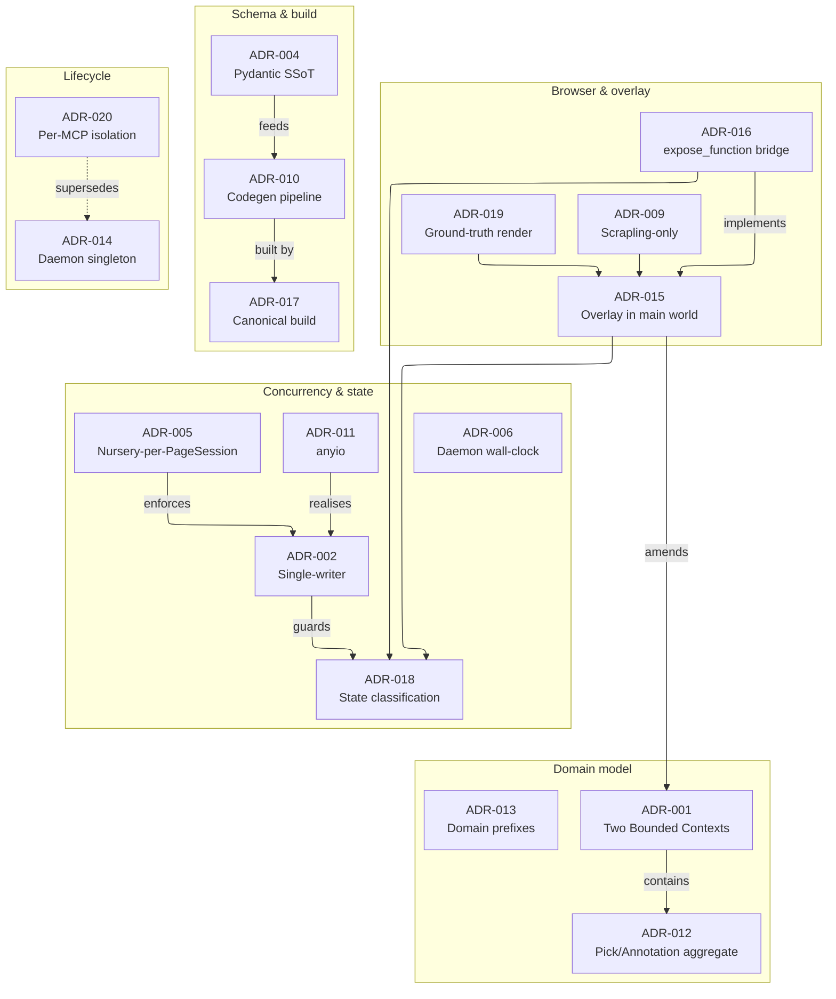

# Architecture Decision Records

This is the decision log for frontprompt — the *why* behind the architecture. Each
record captures one significant decision: its context, the choice made, and the
consequences that follow. Records are immutable once accepted; a decision that no
longer holds is **superseded** by a newer one rather than edited away.

> **Provenance.** These records were authored during the greenfield design phase
> (the predecessor `frontprompt-legacy` was archived 2026-05-13 and rebuilt from
> first principles). The detailed records preserve their original wording. For the
> *current* runtime shape, read [ARCHITECTURE.md](../../ARCHITECTURE.md) — where a
> decision was later amended or superseded, the summary below says so.

## Status at a glance

| # | Decision | Status | Theme |
|---|----------|--------|-------|
| [001](./ADR-001-two-bounded-contexts.md) | Two Bounded Contexts — Programmatic Executor & Interactive Surface | 🟡 accepted · amended | Domain |
| [002](./ADR-002-single-writer-helland.md) | Single-Writer-per-Aggregate (Helland lens) + invariants I1–I6 | 🟢 accepted | Concurrency |
| [003](./ADR-003-python-svelte-stack.md) | Python 3.13 backend + TypeScript / Bun / Svelte 5 frontend | 🟢 accepted | Stack |
| [004](./ADR-004-pydantic-2-13-ssot.md) | Pydantic v2.13.x as schema single-source-of-truth | 🟢 accepted | Schema |
| [005](./ADR-005-nursery-per-pagesession.md) | Nursery-per-PageSession ownership topology | 🟢 accepted | Concurrency |
| [006](./ADR-006-daemon-wall-clock.md) | Daemon wall-clock as idempotency truth | 🟢 accepted | Concurrency |
| [007](./ADR-007-failure-mode-budget.md) | Failure-mode budget — 7 closed classes | 🟢 accepted · closed | Reliability |
| [008](./ADR-008-svelte-5-runes.md) | Svelte 5 with runes as the frontend framework | 🟡 accepted · amended | Stack |
| [009](./ADR-009-scrapling-only-substrate.md) | Scrapling-only browser substrate (pinned, isolated) | 🟢 accepted | Browser |
| [010](./ADR-010-codegen-pipeline.md) | Codegen pipeline — Pydantic → JSON-Schema → Zod/TS | 🟢 accepted | Schema |
| [011](./ADR-011-anyio-concurrency.md) | anyio + structured concurrency (not asyncio-locked) | 🟢 accepted | Concurrency |
| [012](./ADR-012-pick-annotation-aggregate.md) | Pick & Annotation as entities in the PointingSession aggregate | 🟡 accepted · amended | Domain |
| [013](./ADR-013-mandatory-domain-prefix-ubiquitous-language.md) | Mandatory domain-prefix for ambiguous terms (ubiquitous language) | 🟢 accepted | Domain |
| [014](./ADR-014-daemon-singleton-via-lockfile.md) | Daemon-singleton via lockfile (message-hub pattern) | 🔴 superseded by 020 | Lifecycle |
| [015](./ADR-015-overlay-in-page-main-world.md) | Overlay lives in the page main world (Playwright-injected) | 🟢 accepted | Browser |
| [016](./ADR-016-expose-function-bridge.md) | Bridge via Playwright `expose_function` (Phase 1) | 🟢 accepted | Browser |
| [017](./ADR-017-canonical-build-pipeline.md) | Canonical build pipeline with env-guard | 🟢 accepted | Build |
| [018](./ADR-018-state-classification-local-vs-backend.md) | State classification — localState vs backendState | 🟢 accepted | State |
| [019](./ADR-019-ground-truth-overlay-rendering.md) | Ground-truth overlay rendering (no snapshot fallback) | 🟢 accepted | Browser |
| [020](./ADR-020-per-mcp-daemon-browser-session-isolation.md) | Per-MCP-daemon browser-session isolation | 🟢 accepted (supersedes 014) | Lifecycle |

Legend: 🟢 accepted · 🟡 accepted with later amendment · 🔴 superseded.

## How the decisions relate

## Reading order

New to the codebase? Read them in this order for the fastest mental model:

1. [ADR-001](./ADR-001-two-bounded-contexts.md) — the domain split and why it was deferred.
2. [ADR-018](./ADR-018-state-classification-local-vs-backend.md) — local vs backend state (the daily-driver rule).
3. [ADR-002](./ADR-002-single-writer-helland.md) — why one writer, guarded by a lock.
4. [ADR-015](./ADR-015-overlay-in-page-main-world.md) + [ADR-016](./ADR-016-expose-function-bridge.md) — how the overlay reaches Python.
5. [ADR-004](./ADR-004-pydantic-2-13-ssot.md) + [ADR-010](./ADR-010-codegen-pipeline.md) — one schema, generated both ways.
6. [ADR-020](./ADR-020-per-mcp-daemon-browser-session-isolation.md) — why every MCP client gets its own browser.

## Writing a new ADR

Add `ADR-0NN-<kebab-title>.md` with a `**Status**` / `**Date**` header and the
canonical sections — **Context**, **Decision**, **Consequences** — then add a row
to the table above. Never delete a record: supersede it and flip its status to 🔴
with a link to the replacement.
